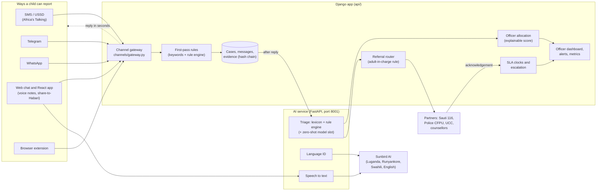

# Habari architecture

Habari is one case engine with many doors. A child can report from whatever they have (a basic phone, WhatsApp, a browser) and every report becomes the same kind of case, triaged, assigned, referred and tracked the same way.

## Overview

## How a report moves

1. **The child writes.** Each channel adapter turns the message into one common call to the gateway (`POST /api/channel/{name}`).
2. **Fast first reply.** The gateway runs the first-pass rules (keyword list plus the rule engine, both plain Python) and replies within seconds. Danger gets the helpline (116) first. USSD sessions time out quickly, so no slow AI call sits in this path.
3. **AI triage after the reply.** Once the case is saved, the AI service scores severity (1 to 4) and category. It can only **raise** severity. Only a person can lower it.
4. **Officer allocation.** A score picks the officer: language match (+3), skill match (+2), same district (+1), minus 0.5 per open case. The reason is saved on the case and a supervisor can override.
5. **Referral.** Severity 4 is referred at once to Sauti 116 and the Police Child and Family Protection Unit (plus UCC and a counsellor for sextortion). If the alleged person is a parent, teacher or other adult in charge, the case is never sent to the family or school.
6. **Alerts and deadlines.** Severity 3 and 4 cases appear in the officers' Alerts box. Each severity has an acknowledgement deadline (15 minutes for severity 4). A missed deadline reminds, then reassigns, then pages the on-call officer and escalates to a second partner.
7. **The child follows up** with their case code (`STATUS HB-XXXXXX`). Status words change as the case is referred, acknowledged and resolved, and a safety check-in follows.

## Components

| Folder | What it does |
|---|---|
| `api/channels/` | Gateway and adapters: SMS, USSD, Telegram, WhatsApp, web chat, voice notes |
| `api/core/` | Case engine: models, first-pass rules, AI triage hook, allocation, referral router, SLA clocks, alerts, follow-up |
| `api/ai_service/` | FastAPI service: lexicon (`lexicon.yaml`), rule engine (`engine/`), language ID, speech to text, Sunbird client |
| `api/dashboard/` | Officer dashboard, case pages, partner board, heat map, `/metrics`, `/about/status` |
| `api/partners_mock/` | Simulated partners that acknowledge referrals (stand-ins for Sauti 116, Police, UCC) |
| `api/polls/`, `api/kb/` | U-Report style polls; safety tips knowledge base |
| `api/extension/` | Browser extension: report from a social media page with evidence |
| `api/eval/` | Test sets and the evaluation script behind `/metrics` |
| `web/` | React app: welcome, age, language, report, chat, confirmation, status, help pages |

## Privacy and safety by design

- **No names.** A child is a pseudonymous ID. The raw phone number or handle sits in a separate vault that only the safeguarding group can see.
- **Nothing kept on the device.** The web chat sets no cookies, pages are never cached, and **Quick exit** wipes the screen and leaves.
- **Location is a district, never coordinates.** Small districts are hidden on the heat map.
- **Identifiers are hashed.** Abuser handles, numbers and links are stored as HMAC hashes, which still lets repeat offenders be matched.
- **Evidence is tamper-evident.** Each item stores a SHA-256 hash chained to the one before.
- **Less exposure for staff.** Officers see a short summary, category and flags first, so they can act without rereading the whole report. Only synthetic data is used; no real images of children exist anywhere in the project.
- **Safe failure.** If the AI service is down, rules still triage (`Rules (AI down)` on the dashboard). If triage itself fails, the case becomes severity 3 for human review. Unreadable text is never treated as safe.

## Running it

Setup is in the [README](../README.md). For the demo: `python manage.py seed_demo`, then run Django on 8000 and the AI service on 8001. Demo officers are `sarah`, `peter` (on call) and others; the password is set by `DEMO_OFFICER_PASSWORD`.
